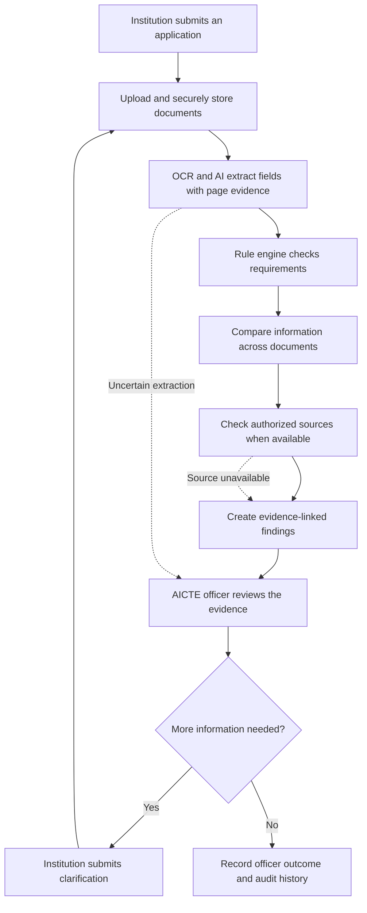

# PRAMAN

**Platform for Regulatory Assessment, Monitoring, Authentication & Notification**

*Every claim needs evidence.*

PRAMAN is a proposed AI-assisted platform to help institutions prepare AICTE approval applications and help authorized reviewers find missing, inconsistent, or unclear information across supporting documents.

> **Project status:** This repository currently contains project documentation and a prototype plan. It is not a deployed application. Live AICTE/government integrations, production processing, and measured accuracy have not been demonstrated.

## Start here

New to PRAMAN? Read these in order:

1. **[Start here: PRAMAN in plain English](docs/START_HERE.md)** — the idea, key terms, and where to begin.
2. **[How the workflow works](docs/03-end-to-end-workflow.md)** — from upload to officer review.
3. **[System architecture](docs/architecture/system-architecture.md)** — how the parts fit together.
4. **[Prototype roadmap](docs/planning/prototype-roadmap.md)** — what to build first.
5. **[Project status](PROJECT_STATUS.md)** — what is documented and what is not yet implemented.

Browse all specifications in the **[documentation index](docs/README.md)**.

## The idea in one picture



**Important:** PRAMAN assists with scrutiny. It must not automatically grant or reject approval. A missing response from an external source does not mean a document is false.

## What makes PRAMAN different?

- **Evidence-linked findings:** each flag should point to the relevant document/page, extracted value, and rule or comparison that triggered it.
- **Compliance Memory Graph:** connects an institution's applications, documents, claims, rules, checks, and officer actions across application cycles.
- **Compliance Drift Engine:** highlights meaningful changes in current evidence and identifies checks that may need to be repeated. A change is a signal to review, not proof of non-compliance.
- **Human-led decisions:** authorized officers review the evidence and remain responsible for official decisions.

## Proposed technology stack

| Part | Planned technology | Purpose |
|---|---|---|
| Web interface | React, Vite, TypeScript | Application and officer screens |
| UI components | Tailwind CSS, shadcn/ui, React Router | Layout, reusable components, navigation |
| API backend | Node.js, Express, TypeScript | Application logic and REST endpoints |
| Database and login | Supabase PostgreSQL, Supabase Auth | Store records and manage identities |
| Permissions and files | PostgreSQL Row Level Security, private Supabase Storage | Restrict access to records and uploaded documents |
| Document processing | Python, RapidOCR, PyMuPDF | Read scanned pages and PDFs |
| AI extraction | Gemini API with structured output | Extract candidate fields into a defined schema |
| Validation | TypeScript rule engine, Zod | Apply testable rules and validate data shapes |
| Testing | Vitest, React Testing Library, Supertest, Pytest | Test frontend, API, and OCR processing |

This is the **planned stack**, not a claim that all these components are already connected. Start with a modular monolith; a separate OCR service can be introduced if implementation needs it. A graph database is not required for the first version.

## What's planned for the first prototype?

Build one complete, small workflow before expanding scope:

1. Support one application category and three selected document types.
2. Upload files privately and keep document versions.
3. Extract a small set of fields and preserve source-page evidence.
4. Run deterministic rules and compare fields across documents.
5. Show findings to an officer for review.
6. Record the review outcome and audit history.

Add live external verification only when access is authorized and technically supported. Any simulated result must be clearly labelled **SIMULATED**.

## Repository map

```text
PRAMAN/
├── README.md                 # Project overview and quick links
├── PROJECT_STATUS.md         # Honest implementation status and next milestone
├── GITHUB_UPLOAD_GUIDE.md    # Repository/documentation guidance
└── docs/
    ├── START_HERE.md         # Beginner-friendly introduction
    ├── README.md             # Index of all documentation
    ├── 01-product-overview.md
    ├── 02-user-roles-and-access.md
    ├── 03-end-to-end-workflow.md
    ├── features/             # Individual feature specifications
    ├── architecture/         # System, data, API, verification design
    ├── planning/             # Roadmap, testing, and demo scenarios
    └── glossary.md           # Project terminology
```

## Safety and trust

- Treat AI outputs as suggestions, not proof.
- Keep every important finding traceable to evidence and a rule or comparison.
- Distinguish verified, unverified, uncertain, unavailable, and simulated results.
- Use only authorized sources and appropriately protected test data.
- Keep rule versions and officer actions auditable.
- Let the competent authority make the official decision.

## Contributing

Before building a feature, read the relevant specification and check [Project Status](PROJECT_STATUS.md). Keep the MVP small, add tests for validation logic, and update documentation when scope or implementation changes.

**Next step:** follow the [prototype roadmap](docs/planning/prototype-roadmap.md) and implement the first end-to-end flow.
