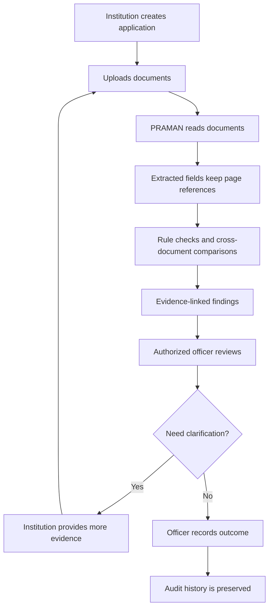

# Start Here: Understand PRAMAN

This page explains PRAMAN without assuming you already know AI, document processing, or regulatory software.

## 1. PRAMAN in 60 seconds

An institution submits an application with several supporting documents. The same facts—such as an institution name, address, date, or identifier—may appear in more than one document.

PRAMAN is designed to help reviewers:
1. Read documents and extract useful fields.
2. Check those fields against configured requirements.
3. Compare details across related documents.
4. Highlight what looks missing, inconsistent, uncertain, or in need of verification.
5. Show the evidence behind each finding.
6. Let an authorized officer review the evidence and record the outcome.

Think of PRAMAN as a **document-review assistant with memory and a paper trail**, not as an automated approval authority.

## 2. Follow one application

If a scan is unclear, PRAMAN should mark the extracted field as uncertain. If a verification service cannot be reached, PRAMAN should record that the source was unavailable. Neither situation is proof that a document is false.

## 3. Key terms in plain English

| Term | Meaning in PRAMAN |
|---|---|
| OCR | Software that reads text from scanned pages or images. |
| Structured extraction | Turning document text into fields such as name, date, number, or address. |
| Confidence | A signal about how reliable an extracted result may be; it is not a guarantee. |
| Rule engine | Ordinary, testable code that checks requirements such as required fields, formats, dates, and configured conditions. |
| Cross-document check | Comparing the same or related facts across multiple submitted documents. |
| Source verification | Checking a claim against an external source when the source is available and access is authorized. |
| Evidence-linked finding | A flag that explains what needs attention and points to its supporting document/page and rule or comparison. |
| Compliance Memory Graph | A set of links between institutions, applications, documents, claims, rules, findings, and review actions over time. The first version can store these relationships in PostgreSQL. |
| Compliance Drift Engine | Logic that notices meaningful changes in current records and identifies which checks may need to run again. A change does not automatically mean non-compliance. |
| Audit trail | A chronological record of important events, versions, and reviewer actions. |

## 4. What uses AI, and what should not?

**AI can help with:** reading difficult document layouts, classifying document types, extracting candidate fields, and suggesting possible inconsistencies.

**Regular code should handle:** exact comparisons, required-field checks, date calculations, configured rule execution, permissions, workflow transitions, and audit logging.

**People remain responsible for:** examining evidence, resolving ambiguous cases, and making official decisions under the applicable process.

## 5. Where to read next

Use this order if you are learning the project:

1. [Product overview](01-product-overview.md) — users, problem, and product principles.
2. [User roles and access](02-user-roles-and-access.md) — who can do what.
3. [End-to-end workflow](03-end-to-end-workflow.md) — the complete process.
4. [System architecture](architecture/system-architecture.md) — how the software pieces connect.
5. [Data model](architecture/data-model.md) — what information must be stored.
6. [Prototype roadmap](planning/prototype-roadmap.md) — implementation order.
7. [Testing and evaluation](planning/testing-and-evaluation.md) — how to test whether it works.
8. [Full documentation index](README.md) — all feature and technical specifications.

## 6. Current project status

The repository currently describes the product and its proposed prototype. Do not assume that the planned screens, OCR, rules, authentication, integrations, or reports already work. See [Project Status](../PROJECT_STATUS.md) for the current implementation boundary and next milestone.

The first milestone is deliberately small: one application category, three document types, secure upload, extraction with page evidence, deterministic validation, cross-document comparison, officer review, and a recorded outcome.
